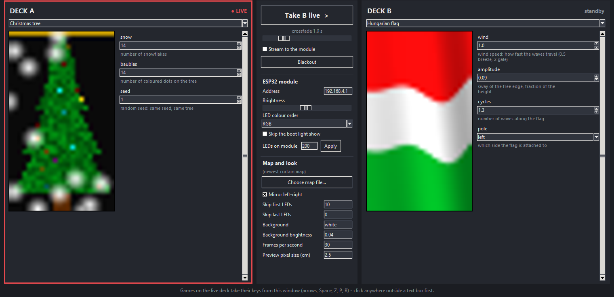
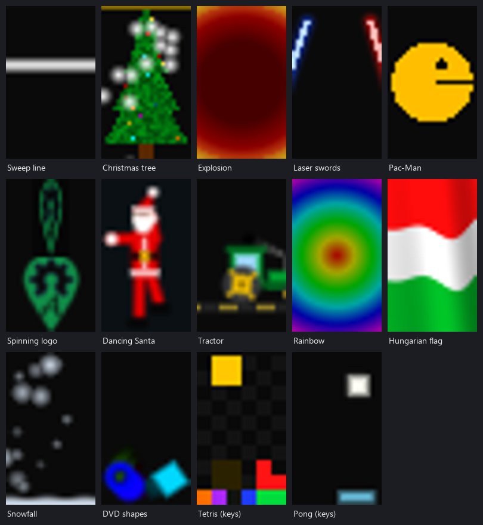

# XMasTractor: a 3D WLED driver

XMasTractor is a driver for addressable LEDs in 3D: map a string with a camera ([MariMapper](https://github.com/TheMariday/marimapper)), choose a viewpoint (and a mirror plane for a symmetric object), and the effects draw on what you see from there. It talks WLED's realtime protocol, drives up to 1000 LEDs per module and any number of modules.

**It needs [MariMapper](https://github.com/TheMariday/marimapper):** the LEDs have to be mapped into 3D first (a MariMapper `led_map_3d.csv`), whatever shape they are hung in: a curtain, a sphere, a tree, a tractor. Without a map you only get the effects' own pixel order; with it, every effect draws on the real positions.

Christmas lights you can play with: an ESP32 firmware that turns a string of addressable LEDs into a network display, plus a Python app and a collection of effects that draw on it. Hang the string as a curtain, map it with a phone camera, and then run a Christmas tree, falling snow, a dancing Santa, a waving Hungarian flag, Tetris, Pong or music-reactive visuals on it.

It runs on the brain board of [AgIsoAuxInputs](https://github.com/gunicsba/AgIsoAuxInputs) (ESP32-S3, LED output on GPIO7). The firmware here is separate and does not use ISOBUS or CAN: the board is only the hardware.





*The pictures above are drawn on a grid with about five times more pixels than the real curtain, the way the app previews them.*

## How it works

```
 Python effects / app  ──  UDP (DDP, port 4048)  ──▶  ESP32-S3  ──▶  LED string (GPIO7)
 (PC, draws frames)                                    (WiFi)
```

- The **firmware** joins your WiFi (and also runs its own access point), receives frames over UDP and shows them. It speaks the WLED realtime protocols (DDP on port 4048, UDP notifier on 21324) and a small part of WLED's JSON API, so [MariMapper](https://github.com/TheMariday/marimapper)'s WLED backend can map the LEDs.
- A **map** (a CSV of where each LED is, in cm) lets the effects draw pictures instead of just pixel sequences.
- The **effects** are small Python scripts. Each one runs on its own or inside the **app**, which has two decks (one live, one to set up in the background), a preview per deck, and controls for the ESP32.

## Quick start

### 1. Flash the firmware

You need [PlatformIO](https://platformio.org/) and the board connected over USB.

```
copy src\secrets.h.example src\secrets.h      (then put your WiFi name and password in it)
pio run -t upload
```

`src/secrets.h` is git-ignored, so your passwords stay out of the repository. You can list more than one network and the module joins the strongest one it can see.

On first boot every tenth LED blinks red until the module is online (on your WiFi, or a phone joined to its own access point), then green for a few seconds, and then it plays an effect of its own. Each module names itself `xmas-<last two bytes of its MAC>`, and its own access point has the same name.

Later updates go over WiFi, either with `pio run -e xmas_ota -t upload --upload-port <its IP>` or by dropping the `.bin` on the module's web page at `/update`. That page (open the module's IP in a browser) also has the built-in effects, a brightness control, and the name and LED count of the module. If several modules are on the network, each has its own name and settings.

### 2. Map the LEDs

This step is required for the 3D features: MariMapper films the string from a few camera positions and works out where every LED is in 3D space. Install it from its own repository and keep it next to this project (it is not part of it).

Hang the string the way it will stay, and run MariMapper from a phone or webcam: `marimapper --backend wled --server <module IP>`. Copy the resulting map to `maridata/` (git-ignored). The scripts read three kinds of map:

- MariMapper's **3D** map (`led_map_3d.csv`, with `x,y,z` columns): see [Looking at a 3D map](#looking-at-a-3d-map) below. This is the one to use for anything that isn't flat.
- A CSV with `index,x_cm,y_cm` columns (positions in centimetres, y up).
- MariMapper's own 2D `index,u,v` files.

There is an example map (a plain 10 × 20 grid) in `maps/`, which the scripts use when `maridata/` has none, so you can try everything without mapping first.

For a map that comes out mirrored (it was shot from behind), tick *Mirror left-right* in the app or set `FLIP_X = True` (it works on 3D maps too, as seen from the viewpoint); if LEDs hang loose past the lit area, set `SKIP_FIRST`. See [Settings](#settings).

#### Looking at a 3D map

The effects draw flat pictures, so a 3D map is first stood upright and then looked at from a **viewpoint**; the effects run on what you see from there.

1. **Stand it upright.** The reconstruction can leave the map turned any way. For a flat sheet like a curtain `MAP_ORIENT = "auto"` does it for you: the long direction becomes up (higher LED numbers higher up), and the side the cameras were on becomes the front. For anything else (a tractor) set `"none"` and turn the map with `MAP_ROTATE_X/Y/Z` until it stands the right way, with its front towards you.
2. **Choose where to look from.** `VIEW_AZIMUTH` (0 = front, 90 = from the right, 180 = from behind), `VIEW_ELEVATION` (90 = from above) and `VIEW_ROLL` tilt the view; `VIEW_DISTANCE` adds perspective for a viewer that many cm away.
3. **Scale.** MariMapper measures in LED spacings, so `MARIMAPPER_UNIT_CM` says how many cm that is (your LED pitch).

The app's **3D map view...** button opens a window with the whole map in real 3D: drag with the mouse to turn it, use the wheel to zoom, and the colours follow the LED numbers (red to violet; bigger dots are nearer). Tick *Show what the effects see* for the flat picture from the viewpoint, with Front / Right / Back / Left / Top presets and sliders for the upright turn and the viewpoint. The decks and their previews follow along. The same settings are command line flags on every script (`--view-azimuth 90`, `--map-rotate-x 90`, ...).

4. **Mirror (a symmetric object).** On a tractor you only need to light one half and let the other copy it. Tick *Pick mode* and click two LEDs on the middle line of the object (say along the centre of the tractor), or type their numbers, then turn the plane about that line with the slider until it cuts the object in half (`MIRROR_LEDS = (12, 340)` and `MIRROR_ANGLE = 0` in the settings, `--mirror-leds 12,340 --mirror-angle 30` on the command line). At angle 0 the plane stands upright through the line. The map is then folded over that plane onto the side the viewpoint is on: every LED on the far side copies its twin on the near side, so both sides of the tractor show the same picture, and the viewpoint decides which side is the 'real' one (viewed from the other side the picture is its mirror image, as it physically would be). *No mirror* removes it.

### 3. Run the app

```
pip install -r scripts/requirements.txt
py scripts/gui.py          (or double-click XMasTractor.bat)
```

Pick an effect for each deck. The live deck is on the strip; the other deck is only previewed, so you can tune it. **Take B live** crossfades over the time you choose. The settings form of each effect is built from the script's own options, so new scripts show up in the app by themselves. The middle panel controls the ESP32 (brightness, LED colour order, LED count, skip the boot light show), the map and the background.

Tetris and Pong take their keys from the app window while their deck is live: arrow keys, Space to drop (Pong: launch), Z rotates the other way, P pauses, R restarts.

### 4. Or run a single effect

Every effect also runs on its own: `py scripts/snow.py`, `py scripts/tree.py`, and so on. Add `--help` to see its options. Settings given on the command line override the defaults for that run.

## Effects

| Effect | Script | What it does |
|---|---|---|
| Sweep line | `sweep.py` | A line that moves across (up, down or bouncing, at any `--angle`), optional rainbow colour |
| Christmas tree | `tree.py` | A green tree with falling snow and twinkling coloured baubles |
| Explosion | `boom.py` | A burning fuse along the strip, then a flash and a red shockwave ring |
| Colliding lines | `collide.py` | Coloured comets rush in from all directions, meet in a flash and a ring of their colours, and shoot on out |
| Running text | `marquee.py` | A message scrolls across (`--text`, colour or rainbow, size, speed, either direction) |
| Laser swords | `swords.py` | Two sabers duelling: wind-up, strike, clash with sparks |
| Pac-Man | `pacman.py` | A chomping Pac-Man, optionally running along eating dots |
| Spinning logo | `logo.py` | Any picture, sampled at each LED and spun like a coin |
| Dancing Santa | `santa.py` | Santa dancing in time with a tempo you set |
| Tractor | `tractor.py` | A tractor driving across with turning wheels, in colours you choose |
| Rainbow | `rainbow.py` | Rainbow rings or a colour wheel around a centre you pick, moving with a BPM |
| Hungarian flag | `flag_hu.py` | The flag waving in the wind, with gusts |
| Snowfall | `snow.py` | Flakes of different sizes, with a snow pile that grows and melts |
| DVD shapes | `dvd.py` | Shapes bouncing around like the DVD logo, with a flash on a corner hit |
| Tetris | `tetris.py` | Playable with the keyboard, or with a bot (`--demo`); `--simple` uses square blocks |
| Pong | `pong.py` | One bar at the bottom, keep the ball in the air; it speeds up on every bounce |
| Music | `music.py` | Reacts to whatever your PC plays: spectrum, VU, rainbow, rings, a flag with water droplets, a dancing stickman, a winking owl |

The music effects listen to the PC's audio output (Windows WASAPI loopback), so Spotify, YouTube or anything else works. Start the music first, then the effect; `--low-latency` makes it react a little sooner. Numpy and pyaudiowpatch are only needed for these.

## Settings

Defaults are in `scripts/config.py`. Put your own values in `scripts/config_local.py` (copy `config_local.example.py`; it is git-ignored). The most useful ones:

| Setting | Meaning |
|---|---|
| `HOST` | The module's address: `192.168.4.1` when you are on its own access point, or its IP on your WiFi |
| `LEDS` | LED count in total, over all modules |
| `LEDS_PER_MODULE` | Most LEDs one module drives (1000) |
| `SKIP_FIRST`, `SKIP_LAST` | Leave the first or last LEDs dark (they are also left out of the picture's size) |
| `FLIP_X`, `FLIP_V` | Mirror left-right or up-down, for a map that came out the wrong way round |
| `BACKGROUND`, `BG_BRIGHTNESS` | The colour and brightness of LEDs an effect leaves unlit |

## Many LEDs: more than one module

One module drives up to 1000 LEDs (every LED takes 30 microseconds to send, so 1000 LEDs update about 30 times a second, and `fps` of 30 is the most to ask for). For a longer string use more modules: give `HOST` a comma separated list in the order of the string, and `LEDS` the total.

```
HOST = "192.168.1.50,192.168.1.51,192.168.1.52"
LEDS = 3000
```

LEDs 0-999 go to the first module, 1000-1999 to the second and so on; each module is set to its own count and numbers its LEDs from 0. The app (address field, brightness, colour order, LED count) and `watch.py` talk to all of them, and the command line has `--host a,b,c` and `--leds-per-module`. Map the LEDs of every module as one string (the numbers continue across modules), or one module at a time. Frames are sent in packets of at most 480 LEDs, so a module of any size works over WiFi.

## Tips

- **Frame rate:** 30 to 60 frames a second is fine over WiFi; at 100 the module starts to lose packets.
- **Stutter:** If the lights stutter, run `py scripts/watch.py` next to your effect. It shows what the module received (frames, longest gap, WiFi signal, drops) so you can tell a busy network from a slow PC. Stalls that come and go with how busy the home network is usually point at a crowded 2.4 GHz channel.
- **Brightness:** The module's brightness setting applies to everything, including frames from the PC.
- **New effects:** A script needs a `build(leds, args)` function that returns `render(t)`, and a `main()` that adds its options to `common.parser(...)` and calls `parse_args()`; the app then picks it up once you add it to the list at the top of `scripts/gui.py`.

## Layout

```
src/        ESP32 firmware (Arduino framework, PlatformIO)
scripts/    effects, the app (gui.py), helpers (common.py, shapes.py, audio.py), settings
maps/       an example LED map
assets/     the AgOpenGPS icon used by the logo effect
docs/       pictures for this README (scripts/make_gallery.py redraws the gallery)
```

## Credits

- [AgIsoAuxInputs](https://github.com/gunicsba/AgIsoAuxInputs): the brain board this runs on.
- [MariMapper](https://github.com/TheMariday/marimapper): mapping the LEDs with a camera.
- [WLED](https://github.com/Aircoookie/WLED): the realtime protocols and JSON shapes the firmware understands.
- `assets/aog_ico.png` is the [AgOpenGPS](https://github.com/AgOpenGPS/AgOpenGPS) icon (Apache License 2.0).

## License

[WTFPL](LICENSE): do what you want.
